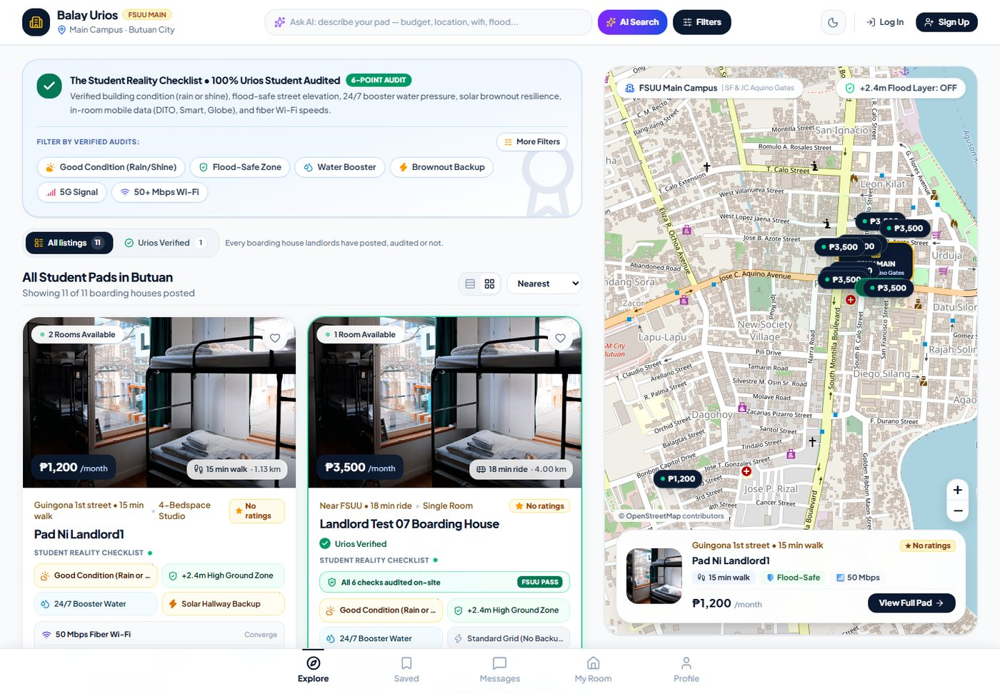
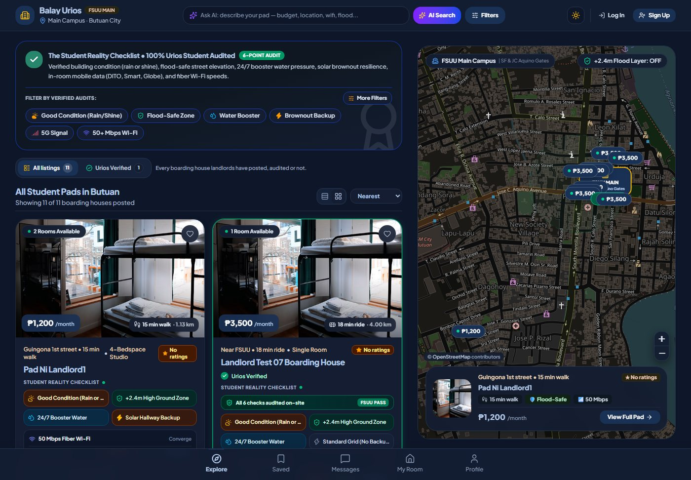
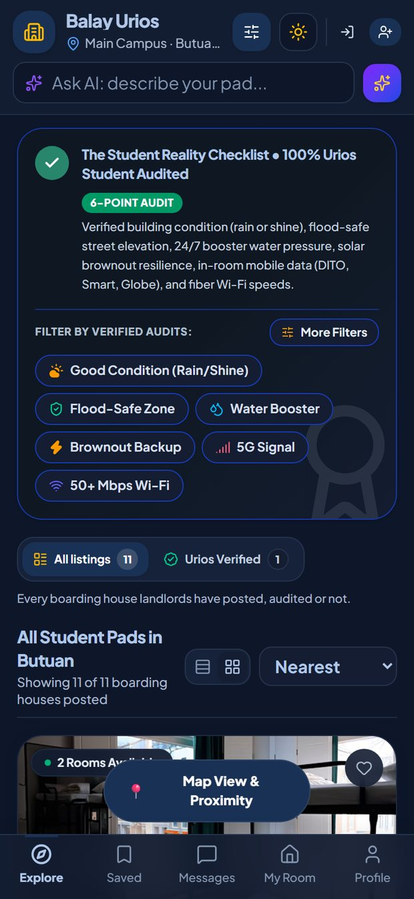
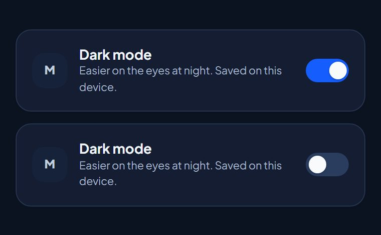

# Balay Urios (Serjon) — FSUU Student Housing Hub

> The easiest way for Urios students to find a verified boarding house near campus, and for landlords to fill their rooms.

Built specifically for the student and landlord community of **Father Saturnino Urios University (FSUU)** in **Butuan City, Agusan del Norte**.

---

## 🌟 Highlights & Butuan-Specific Innovations

1. **Hyper-Local Gate & Commute Proximity:**
   - Filters tailored directly to FSUU Main Campus gates: **San Francisco St. Gate (Main Entrance)** and **J.C. Aquino Ave Gate (College Wing)**.
   - Standard tricycle fares (₱15) and walking times for each location.
   - **Pin-to-Campus Walking Route:** dropping the amber pin in the landlord editor calculates the **real walking route** to FSUU Main (OSRM foot profile, following streets — not a straight line) and fills in the distance plus both the walking and commute minutes. The path is drawn on the picker, and nudging the pin re-routes it. Landlords can still type their own numbers (the form marks them **Manual** and offers one-tap **Recalculate**), and still choose whether students see walk or commute time.
   - Routing runs through a same-origin proxy — `api/route.js` on Vercel, `scripts/vite-route-proxy.js` in dev/preview — because the CSP only allows `connect-src 'self'`. No API key is needed; a straight-line estimate is applied instantly as a placeholder and kept as the fallback if the router is unreachable. Provenance and the route geometry are stored in `gateProximities.mainSFGate` (`distanceSource`, `straightLineMeters`, `route`).

2. **Student Reality Checklist (Butuan Verified):**
   - **Flood-Risk & Monsoon Elevation Rating:** Audited relative to regional Agusan River surge markers (+2.4m high ground certification) and historical 2022–2024 typhoon access.
   - **Uninterrupted Water System:** Verified 1,000L+ overhead stainless reserve tanks + automated booster pumps to eliminate low-pressure bottlenecks before 7:30 AM university classes.
   - **Brownout Resilience Kit:** Solar-powered automated hallway/stairwell lighting and emergency laptop charging ports during ANECO power outages.
   - **Speedtest™ On-Site Audit:** Verified Mbps download/upload reports and in-room signal bars for Globe 5G, Smart 4G LTE, and DITO.

3. **Student-Centric Lifestyle & Cost Features:**
   - **"True Monthly Cost" Calculator:** Students toggle appliances they plan to bring (laptop, rice cooker, electric fan, mini fridge) or estimate aircon sub-metering to see their true monthly total with zero hidden surcharges.
   - **60-Second "Walk-to-Campus" POV Videos:** Sped-up first-person vertical route preview from the boarding house gate to the nearest FSUU gate showing streetlights, pavement quality, and security posts.

4. **Trust, Safety & Landlord Automation:**
   - **"Parent Peace-of-Mind" Share Card:** Generates a clean, printable or Messenger-ready summary highlighting CCTV, curfews, resident caretaker status, and fire exits.
   - **SMS One-Tap Vacancy Bot for Non-Tech Landlords:** Automated bi-weekly check-in via Philippine SMS (*"Reply 1 for Yes, 0 for Full"*) keeping listings accurate without requiring older landlords to use an app.
   - **Verified Boarder Ratings:** Students who actually boarded a boarding house can rate it from 1–5 stars and leave a short review. Everyone can read the ratings, but only verified boarders can write one (enforced in the database).

5. **AI Needs Search (Google Gemini):**
   - Type one sentence — *"barato nga solo room duol sa gate, walay baha, kusog ang wifi"* — and the AI lists the needs inside it (budget, zone, flood-safety, Wi-Fi speed…) and shows which pads actually prove each one.
   - Needs become editable **must / nice-to-have** chips, so the student can drop one and re-rank instantly, then apply the list to the Explore feed.
   - Every filter the model returns is validated against the live listings, and "not audited" is never treated as a match. See [AI Student-Needs Search](#ai-student-needs-search-gemini).

---

## 🌙 Dark Mode

The whole UI can switch to a dark theme — classrooms at night, dorm rooms with
one lamp, and OLED phones all get a proper dark palette instead of a
light-on-dark flip.

- **Where:** the moon/sun button in the header (every screen size), and the
  **Dark mode** switch in **Profile → Appearance**.
- **Remembers the choice:** stored in `localStorage` (`balay-theme`), applied by
  a tiny inline script in `index.html` before the first paint, so there is no
  white flash while the bundle loads.
- **Follows the device first:** until the visitor taps the toggle, the app opens
  in whatever mode the OS is in (`prefers-color-scheme`) and keeps following it
  live. One tap pins an explicit choice.
- **Also themed:** the Leaflet map (dark tile filter, dark zoom/attribution
  chrome), scrollbars, native form controls (`color-scheme`), the mobile browser
  theme colour, and printed-safe colours for tinted notices and amber badges.

| Explore feed · light | Explore feed · dark |
|---|---|
|  |  |

<p align="center">
  
  
</p>

**How it works (and how to keep it working)**

The components keep a single, light-theme `className` list. `src/styles/dark-theme.css`
maps every colour utility Tailwind actually emits — `bg-white`, `text-slate-500`,
`bg-amber-50`, `hover:border-slate-300`, `placeholder:text-slate-400`,
`from-[#0b1a30]` … — onto the dark palette, using unlayered rules so they win
over Tailwind's `utilities` layer without `!important`.

That file is **generated**. `scripts/build-dark-theme.mjs` reads the CSS from the
last build and rewrites it, so re-run it after adding new colours:

```bash
npm run theme:sync   # build → regenerate the palette map → build again
```

`npm run build` already regenerates it automatically (`prebuild`), and
`npm run dev` uses the committed copy. Components that need a one-off tweak can
still use Tailwind's `dark:` variant, which is wired to the same `html.dark` class.

---

## 💸 Rent Payments & Official Receipts

The landlord and student sides of a tenancy now share one payment ledger:

1. **Landlord invoices** — from **My Listings → Payments**, a host sends a request
   for monthly rent, move-in advance + deposit, electricity, water, repairs or a
   custom fee. The tenant, amount, due date, billing period and GCash/bank
   details are attached to the invoice.
2. **Student pays** — the bill appears in **My Room → Rent & Payments** with a
   **Pay Now** button. The student picks GCash / bank transfer / cash / escrow,
   enters the reference number, and submits it for verification.
3. **Landlord verifies** — the ledger flags the submitted reference as
   **Needs Your Confirmation**. Approving it issues the official
   **Balay Urios receipt**; declining it sends the reason back so the student can
   re-submit. A landlord can also record cash immediately with **Record as Paid**.
4. **Receipt on file** — both sides can open, print or save the receipt as PDF
   from the app. Receipts are never issued before a payment is verified.

Approving a tenant application automatically creates the **Move-in Advance &
Security Deposit** invoice (two months' rent) instead of claiming a receipt that
was never paid. The database enforces the workflow: a student can only submit a
reference — never change an invoice amount or mark their own payment as paid.

**Install:** run `supabase/add-payments.sql` once in the Supabase SQL editor
(after `add-tenancy-approval.sql`). It creates the `payments` table, its RLS
policies, the student-update guard trigger, and the landlord receipt policies.

---

## 🚀 Getting Started

### 1. Prerequisites
Ensure you have Node.js (v20+) and npm installed.

### 2. Install Dependencies
```bash
npm install
```

### 3. Run Development Server (Supabase Powered)

With Supabase handling the backend database and API, you only need to run Vite:
```bash
npm run dev
```
- App UI: `http://localhost:5173`
- Optional: add `GEMINI_API_KEY` to `.env` to switch on the **AI Needs Search**
  (see [AI Student-Needs Search](#ai-student-needs-search-gemini)). Everything
  else works without it.

### 4. Deploy

The repo ships ready for **Vercel** (`vercel.json`, `api/ai-search.js`,
`api/ai-status.js`) with **Supabase** as the backend. Full step-by-step:
[DEPLOYMENT.md](DEPLOYMENT.md).

```bash
npx vercel@latest        # preview deploy
npx vercel@latest --prod # production
```

---

## ⚡ Supabase Setup & Data Export Guide

Balay Urios is now configured to use **Supabase** (PostgreSQL + REST API) as its cloud backend.

### Quick Setup in 3 Easy Steps:

1. **Create a Free Supabase Project**:
   - Go to [supabase.com](https://supabase.com) and create a new project.

2. **Run the Database Schema**:
   - In your Supabase Dashboard, click on **SQL Editor** (left sidebar).
   - Open and copy the contents of `supabase/full-setup.sql`.
   - Paste into the SQL Editor and click **Run**.
   - This creates all 12 core tables (`properties`, `campuses`, `appliances`, `users`, `ocular_visits`, `sms_logs`, `saved_properties`, `tenancy`, `curfew_slips`, `receipts`, `payments`, `property_reviews`) and sets up Row Level Security (RLS) policies. No demo accounts or listings are inserted — real accounts are created through Supabase Auth and real listings through the app.
   - Then run `supabase/add-tenancy-approval.sql`, `supabase/add-payments.sql` and `supabase/add-messaging.sql` the same way. Payments adds the rent ledger + receipt workflow; messaging adds the chat tables and the automatic **pad group** for every listing (see [In-App Messaging](#in-app-messaging)).

3. **Configure Environment Variables**:
   - In Supabase Dashboard, go to **Project Settings** -> **API**.
   - Copy **Project URL** and **anon public key**.
   - Open `.env` in this project and add:
     ```env
     VITE_SUPABASE_URL=https://your-project-id.supabase.co
     VITE_SUPABASE_ANON_KEY=your-anon-key-here
     ```
   - Restart `npm run dev`. Your app is now connected to live Supabase!

### Removing Old Demo Data:
If your project previously ran the older seed script, clean the demo listings and accounts with:
```bash
npm run clean:demo
```
The same deletions are documented in `supabase/clean-demo-data.sql`. Admin accounts are assigned directly in the database, not through self-registration.

### Admin Access:

Admins are **not** created through the sign-up form — `api.register()` explicitly rejects the `admin` role. Admin access is decided by `users.role = 'admin'` (and optionally `user_metadata.isAdmin = true`), and it unlocks the **Auditor** tab.

**1. If `users.role` rejects `'admin'`** (older projects have a check constraint limited to `boarder`/`landlord`, which makes admin login impossible and surfaces as `500 Error updating user`):

- Run `supabase/fix-admin-role.sql` once in the Supabase **SQL Editor**. It rebuilds the constraint and promotes the account named in the file.
- Re-running `supabase/full-setup.sql` also repairs the constraint now, but it will not promote anyone.

**2. Create or promote an admin account** (needs `SUPABASE_SERVICE_ROLE_KEY` in `.env`):

```bash
node scripts/create-admin.js admin@balayurios.app "A-strong-password" "Admin Name"
```

Omit the password to have a strong one generated and printed once. Re-running with an existing email promotes that account and resets its password. The script verifies the result by signing in through the anon key.

**3. Log in normally** at **Sign In** with that email/password. The Auditor tab appears in the header and bottom navigation.

### Fixing Listing Ownership & the Audit Crash:

If listings look "mixed up" between accounts, or the admin audit throws
`column properties.buildingCondition does not exist`, run:

- `supabase/fix-accounts.sql` — adds the missing `buildingCondition` column,
  stamps every listing with `landlord.userId` (matched from the landlord email),
  and points each landlord profile at their listing.

### Landlord Account Verification (Auditor Tab):

Verification is a **two-step process with a fixed order**:

1. **Valid ID review** — the landlord submits their government ID (type, number,
   and a photo of the front). An auditor approves or rejects it in the
   **Valid ID — auditor only** card on the landlord's full profile. Rejections
   need a reason, which the landlord sees so they can resubmit.
2. **Account approval** — only after the ID is approved can an auditor mark the
   account **Urios Verified**, either from the same card ("Approve landlord
   account") or from the Auditor tab's landlord dialog. The badge is
   account-level, so it applies to every pad the landlord owns.

The gate is enforced in three places: the auditor UI (the account option stays
locked until the ID is approved), `api.verifyLandlordAccount` (refuses the write
otherwise), and the database trigger from
`supabase/add-verification-workflow.sql`. Rejecting an already-approved ID — or
resubmitting a new one — revokes/pauses the account badge until the current ID is
approved again, because the evidence behind it no longer holds. Running that
migration also clears existing `Urios Verified` flags that have no approved ID
behind them, so a legacy row can no longer show the badge next to "No ID
submitted". The Auditor tab and the landlord's own profile also treat an
unapproved ID as pending, even before the cleanup runs.

- New/updated databases: `supabase/full-setup.sql` includes the verification
  columns automatically.
- Existing databases: run `supabase/add-landlord-verification.sql` once. It
  adds `isUriosVerified`, `verificationStatus`, `verifiedAt`, `verifiedBy`, and
  `verificationNotes`, and normalizes an older integer `isUriosVerified` flag to
  a real boolean.
- Then run `supabase/add-verification-workflow.sql` once to enforce the
  ID-before-account order in the database.

### Deleting an Account (and why the Auditor tab used to keep showing it)

The Auditor tab is not a cached copy: it re-reads **Supabase** every time it
opens (`api.getLandlords()` plus `api.getLandlordIdStatuses()`), and the
**refresh** button next to the search box re-runs both reads. What it reads,
though, is `public.users` and `public.landlord_ids` — profile tables that are
**not** linked to `auth.users` by a foreign key. Deleting a user in
**Authentication → Users** only removed the auth row, so the profile row and the
valid-ID submission survived and kept showing up under **Landlord Accounts** /
**Pending audit** with no way to sign in again.

Run `supabase/fix-deleted-accounts.sql` once in the Supabase **SQL Editor** to
close that gap. It is idempotent and does three things:

1. Installs an `AFTER DELETE` trigger on `auth.users` that deletes the profile
   row, the `landlord_ids` row and the saved listings. Deleting an account in
   Authentication now removes it from the audit immediately (messaging rows
   already cascade through `add-messaging.sql`).
2. Adds the `live_landlord_accounts()` RPC, which returns only landlord profiles
   that still exist in `auth.users`. `api.getLandlords()` reads through it, so
   even a row orphaned before the trigger existed cannot reappear in the audit.
   On a project without this migration the RPC is missing and the app falls back
   to the plain table read, so nothing breaks.
3. Runs a one-time cleanup that deletes profile / valid-ID rows whose auth
   account is already gone — this is what removes the stale entries you are
   looking at right now. Rows that never had an auth account (legacy seeded demo
   profiles such as `user-student-jc`) are removed by the same rule.

Listings, tenancy, receipts and curfew slips are **not** deleted, because they
are business records rather than account data: a removed landlord's pads stay
online so you can reassign or delete them deliberately, and they simply stop
showing an Urios Verified host. ID photos already in the private `landlord-ids`
bucket stay in Storage — delete the `<auth uid>/` folder there if you want them
gone as well.

`supabase/full-setup.sql` ships the same delete trigger and RPC, so new
databases get this behaviour from the start.

### Explore Feed: Urios Verified vs All Listings

The Explore feed has a two-way toggle above the results heading:

- **All listings** (default) — every boarding house landlords have posted,
  audited or not. Nothing is hidden until the searcher asks for it.
- **Urios Verified** — only pads the FSUU student housing committee inspected and
  badged. "Verified" here is the listing-level flag
  (`properties.badges.isUriosVerified`), the same one rendered as the green
  rosette on cards, the map pin, and the Auditor tab's verified counter.

Each option shows how many pads it contains, so the searcher can see the split
before switching. The choice composes with search, zone/budget/checklist filters
and sorting, and it drives the map too (the sticky desktop map and the mobile
full-screen map both render the same filtered list). If a verified-only search
comes back empty, the empty state offers **Show all listings** next to **Clear All
Filters** — which also returns the toggle to **All listings**.

### In-App Messaging

The **Messages** tab is a Messenger-style inbox with three kinds of chat:

- **Pad groups (automatic):** every listing gets exactly one dedicated group chat, named `"<Pad name> · Pad Group"`. It is created by the database the moment the listing is created, the landlord who owns the listing is added automatically, and every **approved boarder** of that pad (an active `tenancy` row) is added automatically too. Approving a boarding application puts the new boarder in the group; ending a tenancy takes them out. Nobody has to create it or invite anyone, and it stays correct even if the boarder never opens the tab.
- **Direct chats:** any signed-in user can search for another account (landlord, student, or auditor) and start a 1:1 conversation. Starting a chat that already exists reopens it instead of duplicating it.
- **Manual group chats:** only landlord accounts can create one. The landlord who created the group is recorded as its landlord, and only that account can add or remove members. Everyone else sees the member list read-only.

Pad-group membership is **derived** from the pad, so it is read-only in the UI: a landlord cannot remove an active boarder by hand (the database re-adds them on the next sync, and the RPC refuses outright).

#### Messaging a landlord straight from a board listing

Every listing now has a **Message** action, so a student never has to hunt for the
Messages tab or a phone number:

- **Explore feed** — the chat button on each card (expanded and compact views).
- **Pad details** — a message button on the landlord card and a "Message the
  Landlord" button in the booking panel.
- **Landlord profile** — the bottom sheet and the full profile page both have a
  "Message landlord" button.
- **My Room** — active boarders get a "Talk to your landlord" card, and a
  **pending or declined application** gets the same button (it resolves the pad
  from the application row).

Tapping one opens (or reuses) the 1:1 direct chat with that host in the Messages
tab, with a listing-specific opening line pre-filled in the composer — it is
**never sent automatically**, the student can edit or clear it. Nothing is
duplicated: starting a chat that already exists reopens the same thread.

The host account is resolved client-side from the listing's `landlord` JSON, in
the same order ownership is resolved elsewhere: `landlord.userId` →
`landlord.email` → `landlord.name` (landlord accounts only). The button hides on
a landlord's own listing, and if the host has no Balay Urios account yet the app
says so and points at the phone number instead of failing silently.

No migration is needed for this — it is a UI entry point onto the messaging
tables and RPCs created by `supabase/add-messaging.sql`.

#### Profiles behind a chat head

In the **Messages** tab, tapping someone's avatar (chat head) opens their profile
without leaving the inbox — this works for **landlord and student accounts alike**:

- the avatar in the conversation list (tapping the row still opens the chat),
- the avatar in the thread header, plus the **Profile** button beside it,
- a sender's avatar or name inside a group / pad-group thread.

`api.getChatProfile(userId)` loads the public profile row and the context that
makes the conversation meaningful: for a **landlord** their verification state
and every listing they own (tap one to open the pad), for a **boarder** their
course, year level and — only when RLS allows the caller to read that tenancy —
the pad they board. Parent/guardian contacts and student IDs are deliberately
excluded, because a chat profile is visible to everyone in the thread, not just
to the host.

Run `supabase/add-messaging.sql` once in the Supabase **SQL Editor**. It creates the `conversations`, `conversation_members`, and `messages` tables with their RLS policies and membership functions, adds them to the `supabase_realtime` publication, and installs the pad-group triggers. It also **backfills a pad group for every listing that already exists** (landlord + current boarders added), so old listings get their group on the next run.

It is safe to re-run — re-running is also the repair step when messaging looks empty:

- `full-setup.sql` / `rls-policies.sql` used to drop **every** policy in `public`, including the messaging policies. Re-running them left RLS enabled with no policy, so chat lists came back empty and inserts failed with `permission denied for table messages`. Both files now skip the messaging tables, and re-running `add-messaging.sql` restores the policies.

Membership changes are rejected by the database unless the caller manages that group, so the rules hold even outside this UI.

> Realtime note: if new messages do not stream in live, check **Database → Replication** in the Supabase dashboard and confirm `messages`, `conversation_members`, and `conversations` are in the `supabase_realtime` publication (the migration adds them).

### Pad groups (details)

| Piece | Where | What it does |
|---|---|---|
| `conversations."propertyId"` | `add-messaging.sql` | Marks a conversation as the pad group of a listing (unique, cascades on listing delete) |
| `pad_group_sync(property_id)` | `add-messaging.sql` | Creates/repairs the pad group and rebuilds membership from the landlord + active boarders |
| `ensure_pad_group(property_id)` | RPC | Open/repair a pad group (pad's landlord, its boarders, admins) |
| `sync_pad_group(property_id)` | RPC | Force a membership re-sync (pad's landlord, admins) |
| Triggers on `properties`, `tenancy`, `users` | `add-messaging.sql` | Create the group on listing insert; add a boarder on approval; remove them when the tenancy ends |

Every trigger is exception-safe: a messaging error can never block creating a listing, boarding a pad, or editing a profile.

### AI Student-Needs Search (Gemini)

Plain Explore search is a substring match over listing fields, so it only works
when the student already talks like the database ("Aircon", "Flood-Safe Zone").
Real requests look like *"barato, duol sa gate, walay baha, kusog wifi"* — and
those returned nothing. The AI search closes that gap: one Gemini call turns the
student's sentence into a **numbered list of the needs behind it**, then shows
which pads can actually prove each need.

**What the student sees**

1. A sparkles **AI** button beside the search box (desktop and mobile), plus an
   "Let AI list what you need" row in the normal recommendation dropdown.
2. They type a sentence and get back a needs list — each need has the student's
   own words as evidence, a **Must / Nice** toggle and a verdict: *"3 pads prove
   it"*, *"not audited yet"*, or *"no pad in Butuan yet"*.
3. Below it, pads are ranked against those needs with a short reason each
   ("₱3,200 · flood-safe · 4 min walk"), and "2/3 must-haves" badges.
4. **Apply to Explore** turns the must-have needs into the normal filters; a
   banner above the feed keeps the needs visible and editable ("Edit list").

Toggling a need off, or switching Must → Nice, re-ranks instantly — the verdicts
for every listing are returned in the same call, so no extra API request is
needed per edit.

**Why it is not a chat toy: the trust rules**

- Only *must* needs whose filters exist in the app are applied. A need like
  "quiet" becomes a visible requirement and a ranking input, not a fake filter.
- A must-have that **no listing can prove** is kept on the list but deliberately
  **not applied**, so the feed never goes empty because of an unaudited field.
- `null` in the catalog means *unknown*, never *absent*. Unknown facts land in
  the "not audited" column; they are never counted as a match.
- Every listing id, zone, amenity, room type and budget from the model is
  validated against the live catalog. Invented listings are dropped with a
  warning; out-of-range budgets clamp; unknown zones/amenities are discarded.
- The needs panel always shows which claims come from the FSUU on-site audit
  and which are unverified, and reminds the student to confirm with the landlord.

**Setup (3 steps)**

1. Create a free key at [aistudio.google.com](https://aistudio.google.com) →
   **Get API key**.
2. Add it to `.env` (never commit it):
   ```env
   GEMINI_API_KEY=your-key-here
   ```
3. Restart `npm run dev`. The header button is ready immediately; without a key
   the panel shows these same instructions instead of failing silently.

Optional overrides: `GEMINI_MODEL` (default `gemini-3.6-flash`, with automatic
fallback to `gemini-3.5-flash` → `gemini-flash-lite-latest`) and
`GEMINI_API_BASE_URL` (useful for a proxy or a test stub).

**Where the key lives**

The browser calls `/api/ai-search`, a tiny middleware in
`scripts/vite-ai-proxy.js` mounted on the dev server **and** on `vite preview`.
That middleware reads `GEMINI_API_KEY` from `.env` and calls Google itself, so
the key never enters `dist/` or the browser bundle. Rate-limited to 12 searches
per minute per client, a 45 s per-model cap inside a 90 s total budget with model
fallback, and it logs model + latency (never the key) to the console.

`VITE_GEMINI_API_KEY` exists only as a fallback for static hosting with no
serverless function. It *is* compiled into the bundle — treat it as public:
restrict it by HTTP referrer in Google Cloud, or (better) deploy the same
middleware as a serverless function and keep using `/api/ai-search`.

**Failure behaviour**

No key, bad key, expired quota, blocked prompt, timeout, malformed JSON and an
empty catalog each get their own message in the panel, with a retry action.
Nothing is cached on failure; successful answers are cached in `sessionStorage`
for 30 minutes per query + catalog snapshot, so re-opening a search is instant.

**Files**

| File | Role |
|---|---|
| `src/services/ai/aiNeeds.js` | Prompt, catalog compaction, filter validation, JSON parsing, need ranking, filter patch. Shared by the browser and the proxy; no framework, no side effects. |
| `src/services/aiSearch.js` | Browser client: key/status probe, proxy call with fallback, timeouts, typed errors, 30-minute cache. |
| `scripts/vite-ai-proxy.js` | Local Gemini proxy (dev + preview), model fallback, rate limit, error mapping. |
| `src/components/AiNeedsSearchModal.jsx` | The needs panel: setup card, loading, needs list, ranked pads, apply. |
| `src/App.jsx`, `src/components/Header.jsx` | Entry points (the header search box launches AI search), filter application, and the "needs you listed" banner on the feed. |

**Limits & privacy**

- Up to 60 listings per request (vacant, verified and cheapest first when the
  catalog is larger); the panel states how many of how many were read.
- Only the student's sentence plus compact listing facts (name, price, zone,
  room type, amenities, checklist flags, walk minutes) are sent to Google
  Gemini. No names, emails, phone numbers or account details.
- Tests: `npm run test:ai` runs 21 unit tests plus 7 proxy integration tests
  against a stub Gemini server — no key and no network required.

### Security & RLS:

The original setup enabled Row Level Security but wrote every policy with
`USING (true)` / `WITH CHECK (true)`. **That is a bad practice**: it means any
client holding the public anon key (including a guest or another user) could
update or delete anyone's listing, profile, tenancy, or curfew slip. That is
precisely how listing data gets overwritten or removed by the wrong account.

- `supabase/rls-policies.sql` replaces those policies with owner-scoped rules
  (a landlord can only modify their own listings; users can only modify their
  own profile; admins bypass via `user_metadata.isAdmin`).
- Run it **after** `fix-accounts.sql` (it requires `landlord.userId` to be set).
- Run `supabase/add-property-reviews.sql` to enable verified-boarder ratings.
  The public can read ratings, but only a student with an active or ended
  tenancy on that boarding house can insert or update one.
- `full-setup.sql` now ships with the same hardened policies for fresh projects.

---


## 🛠️ Supabase PostgreSQL Schema & Tables

All database queries are handled directly via the official Supabase Client (`@supabase/supabase-js`) with Row Level Security:

| Table | Description |
|---|---|
| `properties` | Detailed student pads, landlord information, 6-point reality audit, photos & amenities |
| `campuses` | FSUU Main Campus gates, coordinates, and nearby zones |
| `appliances` | Appliance catalog with monthly submeter electrical rates |
| `users` | Student boarders and verified landlord profiles linked with Supabase Auth |
| `ocular_visits` | Scheduled visits with student ID and time slot |
| `sms_logs` | Audit trail of automated landlord vacancy check-ins |
| `tenancy` | Official digital tenancy passes, room assignments, and live submeter tracking |
| `curfew_slips` | Digital curfew exemption slips for hospital/clinical duties |
| `receipts` | Official verified rent escrow receipts |
| `payments` | Landlord-issued rent/utility invoices, student payment references, verification status, and receipt links |
| `saved_properties` | Student bookmarks and saved boarding houses |
| `property_reviews` | Student ratings (1–5 + review) for a boarding house; only students who boarded may write one |
| `conversations` | Direct chats, manual group chats, and one automatic **pad group** per listing (`propertyId`) |
| `conversation_members` | Chat participants, roles, and per-user read markers (pad groups stay in sync with tenancies) |
| `messages` | Chat messages streamed live through Supabase Realtime |

---

## 📁 Project Architecture

```
serjon/
├── src/                                  # Pure Client-Side Supabase-Powered React App
│   ├── components/                       # UI components (Pads, Tenancy, Filters, Maps, Messages, Modals)
│   │   ├── AiNeedsSearchModal.jsx        # AI needs list + ranked pads panel
│   │   └── ThemeToggle.jsx               # Header moon/sun button + Profile switch
│   ├── context/                          # AuthContext (Supabase Auth Session Management)
│   │   └── ThemeContext.jsx              # Light/dark theme, persistence, OS preference
│   ├── styles/dark-theme.css             # Generated dark palette map (npm run theme:sync)
│   ├── lib/                              # supabase.js (createClient with persistSession)
│   ├── services/                         # api.js (100% direct-to-Supabase query layer)
│   │   ├── aiSearch.js                   # AI search client (proxy call, errors, cache)
│   │   └── ai/aiNeeds.js                 # AI prompt, catalog, filter validation, ranking
│   ├── utils/                            # checklist.js (Student Reality Checklist helpers)
│   ├── App.jsx                           # Root layout & routing
│   └── main.jsx                          # React 19 entry point
├── supabase/                             # Database migrations
│   ├── full-setup.sql                    # Combined 1-click schema + RLS script
│   ├── fix-deleted-accounts.sql          # Keeps the Auditor tab in sync with Supabase Auth
│   └── clean-demo-data.sql               # Removes legacy seeded demo rows
├── scripts/                              # Helper administrative scripts
│   ├── build-dark-theme.mjs              # Regenerates src/styles/dark-theme.css
│   ├── clean-demo-data.js                # Deletes demo listings, users, and auth accounts
│   ├── vite-ai-proxy.js                  # Server-side Gemini proxy (key never in the bundle)
│   ├── test-ai-needs.mjs                 # Unit tests for the needs contract
│   └── test-ai-proxy.mjs                 # Proxy integration tests (stub Gemini, no key)
├── vite.config.js                        # Vite + Tailwind + the AI proxy plugin
└── package.json                          # Vite + React + Tailwind v4 + Supabase client
```

